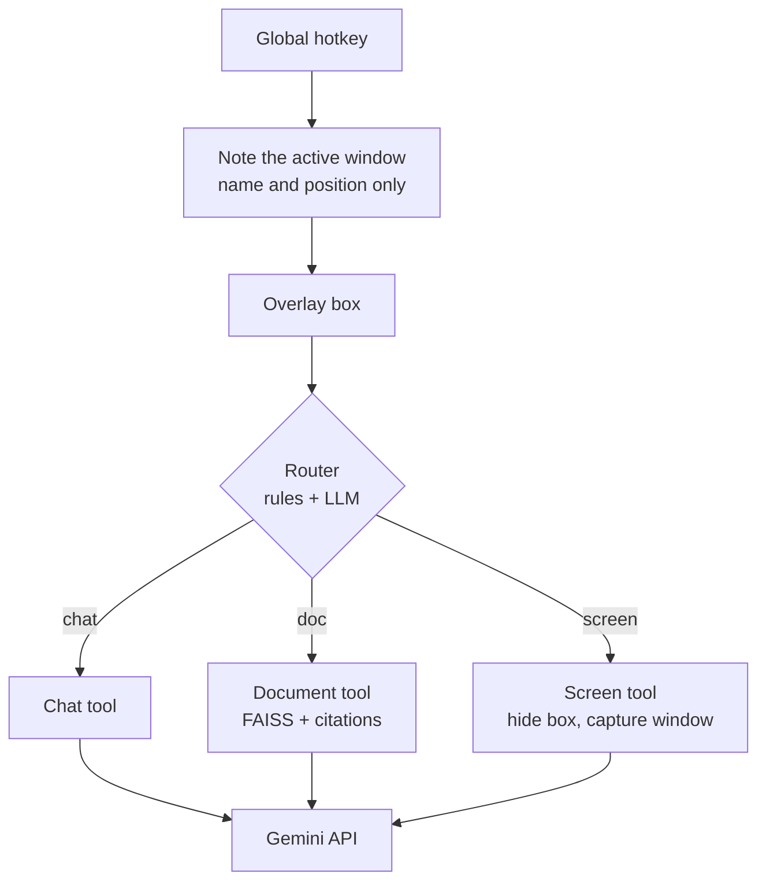

# AI Buddy

**A one-hotkey desktop assistant for Windows.** Press a shortcut from any window and ask a question. AI Buddy answers from general knowledge, from your own PDFs (with page citations), or from what is on your screen, and it decides which one to use.


<!-- Add a short screen recording here once you have one, for example docs/demo.gif:

-->

## What it does

- **One hotkey, any window.** `Ctrl+Alt+Space` opens a small overlay on top of whatever you are doing.
- **Three skills, chosen automatically.**
  - *Chat*: general questions and conversation.
  - *Documents*: questions about PDFs you added, answered with citations such as `[report.pdf, p. 7]`.
  - *Screen*: "take a look at this window and tell me what is wrong". The screenshot is taken only when the question needs it.
- **A visible conversation.** The overlay keeps the whole chat for the session, with shared memory across all three skills.
- **Privacy by design.** No screenshot at hotkey time, a blocklist for password managers and banking windows, and a visible note whenever the screen was used. See [Privacy](#privacy).

## Quick start

Requires Windows 10/11, Python 3.10 or newer (from python.org, which includes Tkinter), and a free Gemini API key from [Google AI Studio](https://aistudio.google.com/apikey).

```powershell
git clone https://github.com/amit1113/AI-buddy-Rag-based-chatbot-enhanced-.git
cd AI-buddy-Rag-based-chatbot-enhanced-
python -m venv .venv
.venv\Scripts\activate
python -m pip install -r requirements.txt
copy .env.example .env
notepad .env          # paste your key after GEMINI_API_KEY=
python buddy.py
```

Keep the terminal window open (minimized is fine). Press **Ctrl+Alt+Space** from any window.

## Using it

1. Switch to any window and press the hotkey. The box shows which window you were in.
2. Type a question and press Enter. Examples:
   - `What is gradient descent?` goes to chat.
   - `What is the total fare in the taxi bill?` goes to your documents.
   - `Take a look at my active tab and tell me what this article is about` goes to the screen.
3. `Esc` or the hotkey again hides the box. The conversation stays until you quit or type `/clear`.

To add documents, type `/add "C:\path\to\file.pdf"` in the box. To skip the automatic choice, start a message with `/chat`, `/doc` or `/screen`.

| Command | What it does |
|---|---|
| `/chat <question>` | General chat, never uses documents or the screen |
| `/doc <question>` | Answer only from your added documents |
| `/screen <question>` | Look at the window you were in |
| `/add <path>` | Add a PDF to your documents |
| `/list` | Show added documents |
| `/remove <file name>` | Remove a document |
| `/clear` | Forget the conversation (memory and visible chat) |
| `/quit` | Stop AI Buddy |

There is also a terminal version, `python cli.py`, where `/screen` gives you a few seconds to switch windows.

## How it works



**Documents (RAG).** PDFs are read page by page (`pypdf`) and split into about 800-character chunks with overlap, cut at sentence boundaries where possible. Each chunk keeps its file name and page number. Chunks are embedded with Gemini embeddings, normalised, and stored in a FAISS inner-product index that is saved to disk, so documents survive restarts. A follow-up like "what about the second one?" is first rewritten into a standalone search query using the conversation. The top chunks go to the model with a prompt that requires citations and tells it to say so when the answer is not in the documents. When it says so, no sources are shown.

**Router.** Typed commands (`/chat`, `/doc`, `/screen`) always win. Otherwise a hybrid strategy picks the tool: cheap regex rules settle clear-cut cases (for example "this error", "in my report"), and a short temperature-0 Gemini call decides the rest, given which tools are actually possible (documents added? a window available?) and which tool was used last. If the model call fails, it falls back to chat, never to a screenshot.

**Screen.** Pressing the hotkey records only the active window's name, title and position. If the router decides the question needs the screen, the overlay hides for a moment, that window is captured with `mss` (using the window's real bounds, DPI-aware), the overlay returns, and the image goes to Gemini together with the question.

**Reliability.** All model calls go through one module (`core/llm.py`) with a request timeout, retries with exponential backoff on busy or rate-limit errors, and an automatic fallback model.

### Project structure

```
.
├── buddy.py              overlay app: hotkey + window
├── cli.py                terminal version
├── try_docs.py           command-line tester for the documents tool
├── app/
│   ├── hotkey.py         global hotkey (Windows RegisterHotKey; pynput elsewhere)
│   ├── presenter.py      overlay behaviour, no widgets in it
│   └── overlay.py        Tkinter window
├── core/
│   ├── assistant.py      message -> router -> tool, shared memory
│   ├── router.py         /chat /doc /screen commands
│   ├── intent.py         automatic routing: rules + LLM classifier
│   ├── llm.py            the only file that talks to Gemini
│   └── config.py, memory.py, reply.py
├── tools/
│   ├── chat.py
│   ├── docs/             ingest.py, store.py, qa.py
│   └── screen/           window.py, capture.py, context.py, tool.py
├── evaluation/           routing and retrieval benchmarks, saved results
└── data/                 local index and last capture (git-ignored)
```

## Configuration

Settings live in `.env` (see `.env.example`):

| Variable | Default | Purpose |
|---|---|---|
| `GEMINI_API_KEY` | none | Your API key (required) |
| `GEMINI_CHAT_MODEL` | `gemini-flash-latest` | Model for answers and routing |
| `GEMINI_FALLBACK_MODEL` | `gemini-flash-lite-latest` | Used when the main model stays busy |
| `GEMINI_EMBED_MODEL` | `gemini-embedding-001` | Embeddings for documents |
| `HOTKEY` | `ctrl+alt+space` | Modifiers plus one key, joined by `+` |
| `AUTO_ROUTE` | `hybrid` | `hybrid`, `rules`, `llm` or `off` (`off` = plain text always goes to chat) |
| `SCREEN_BLOCKLIST` | password managers, `netbanking` | Words in an app name or window title that are never captured |
| `SCREEN_DELAY_SECONDS` | `5` | Terminal version only: time to switch windows after `/screen` |

Model names change over time; if a model is rejected, copy a current name from Google AI Studio.

## Privacy

**Sent to the Gemini API:** your question, the recent conversation (last 20 messages), retrieved document excerpts when you ask about documents, and a screenshot of one window only when a question is routed to the screen. For routing, the app name of the active window may also be sent. Check the terms of the Gemini API plan you use for how Google handles this data.

**Stays on your computer:** your PDFs, the vector index (`data/index/`), and the last screenshot (`data/last_capture.jpg`, so you can see exactly what was sent; turn it off with `SAVE_LAST_CAPTURE = False` in `core/config.py`). Your API key stays in `.env`, which is git-ignored.

**Never captured:** windows matching the blocklist. The check runs when you press the hotkey and again just before a capture. Screenshots are never taken in the background and never taken for general questions.

## Evaluation

Measured by the scripts in `evaluation/`, with every result saved in `evaluation/results/`.

**Routing accuracy**, 52 labelled questions (chat, documents and screen, with and without follow-ups), run on 15 Oct 2026:

| Strategy | Accuracy |
|---|---|
| Rules only | 90% (47/52) |
| Model only | 98% (51/52) |
| **Hybrid (used by the app)** | **100% (52/52)** |

The rules alone settled 25 of the 52 questions, so about half of plain questions need no extra model call. When the model is needed, the routing call averaged 2.4 seconds.

**Read these numbers with care.** The question set and the rules were written by the same person, so 100% shows the design works but is optimistic for real-world use. The set is also small. Real usage questions would be a harder test.

**Retrieval.** `make_retrieval_cases.py` drafts test questions from your PDFs and `run_retrieval_eval.py` compares chunk sizes on hit rate at k and MRR. A first run on a 10-page PDF with generated questions scored 100% at every chunk size. That means the test was too easy to separate them (generated questions reuse the page's own wording), so no claim is made about the best chunk size yet. A harder benchmark with reworded questions and several similar documents is planned.

```powershell
python evaluation/run_routing_eval.py
python evaluation/make_retrieval_cases.py "C:\path\report.pdf" --n 25
python evaluation/run_retrieval_eval.py "C:\path\report.pdf" --cases evaluation/retrieval_cases.json
```

## Limitations

- The overlay and window detection are **Windows only**. On other systems the screen tool falls back to the full screen and the overlay is untested.
- The screen tool sees only the **visible part** of a window, so a long article is not read in full.
- The overlay briefly hides itself during a screen capture, which causes a short flicker.
- **Scanned PDFs** (images without text) are not supported yet; there is no OCR.
- Answers depend on a cloud model, so you need internet access and may hit API rate limits on a free key.
- Only PDF documents are supported.

## Roadmap

- [ ] Use selected text exactly, instead of reading it from a screenshot
- [ ] Browser extension that reads the full text of a web page
- [ ] Harder retrieval benchmark (reworded questions, several similar documents)
- [ ] Faster routing with a lighter model for the decision
- [ ] OCR for scanned PDFs
- [ ] Start with Windows and run from a tray icon
- [ ] Optional local model backend for fully offline use

## Troubleshooting

- **`Could not register the hotkey`**: another program uses it. Set `HOTKEY=ctrl+alt+b` in `.env`.
- **`503 UNAVAILABLE` or a busy model**: handled by retries and the fallback model; if it persists, wait a minute.
- **`Could not load the window toolkit`**: reinstall Python from python.org with the "tcl/tk" option ticked.
- **Wrong window captured**: open `data/last_capture.jpg` to see what was sent, and check the window name shown in the box.

---

Built by [@amit1113](https://github.com/amit1113). Started from a "chat with PDFs" tutorial and extended into a multi-skill desktop assistant.